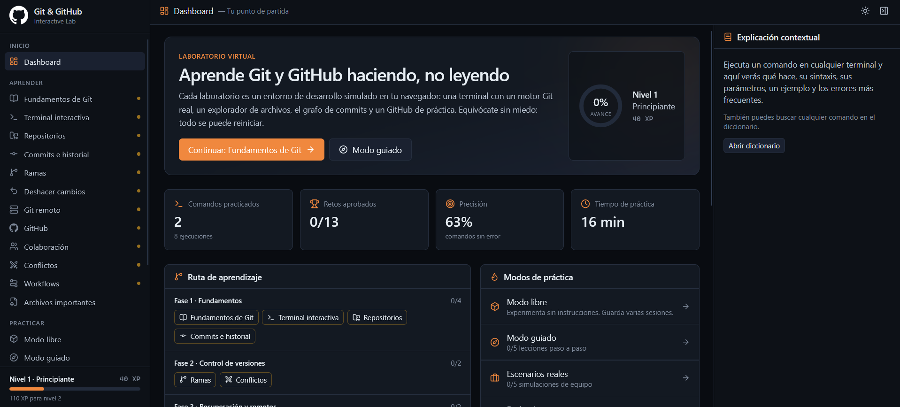

# Git & GitHub Interactive Lab

Laboratorio virtual para aprender **Git y GitHub** practicando. No es una web de apuntes: cada módulo tiene un entorno de desarrollo simulado dentro del navegador (terminal Bash, explorador de archivos, editor de código, grafo de commits y un GitHub de práctica). Todo eso funciona sobre un **motor de simulación de Git** que mantiene el estado real del repositorio.

- Funciona solo en el navegador: no necesita backend ni cuenta de GitHub.
- El progreso y los laboratorios se guardan en `localStorage`.
- Toda la interfaz está en español. Los mensajes de la terminal imitan los de Git real (en inglés) y van acompañados de pistas educativas en español.

---

## Cómo ejecutarlo

Requisitos: **Node.js 20 o superior** (probado con Node 24) y npm.

```bash
npm install        # instala las dependencias
npm run dev        # servidor de desarrollo → http://localhost:5173
npm test           # pruebas unitarias del motor y del contenido (Vitest)
npm run build      # comprobación de tipos + build de producción en dist/
npm run preview    # sirve el build de producción
```

---

## Qué incluye

### Módulos de aprendizaje (barra lateral)

| Módulo | Qué se practica |
| --- | --- |
| Dashboard | Avance total, nivel, ruta de aprendizaje, logros y accesos rápidos |
| 1. Fundamentos | Conceptos con visualización **en vivo** de los tres estados (Working Directory → Staging → Repositorio) |
| 2. Terminal interactiva | Terminal tipo Bash con motor Git, autocompletado, historial y tareas que se validan solas |
| 3. Repositorios | Explorador estilo VS Code con el estado Git de cada archivo (U/M/A/D/!) |
| 4. Commits e historial | Línea de tiempo, grafo, detalle de cada commit, comparación entre commits, SHA y Conventional Commits |
| 5. Ramas | Visualizador de ramas, punteros y HEAD; acciones rápidas que ejecutan comandos reales |
| 6. Deshacer cambios | Tabla de qué toca cada comando y 6 escenarios de "me equivoqué" que hay que recuperar |
| 7. Git remoto | Comparación local ↔ remoto, commits pendientes de subir y de bajar, simulación de compañeros |
| 8. GitHub | GitHub simulado: repositorios, PRs, revisiones, issues, forks, stars, watch, Projects, Actions, Releases, Pages, protección de ramas y permisos |
| 9. Colaboración | Tres desarrolladores (cada uno con su clon) y un repositorio central; validador de Conventional Commits |
| 10. Conflictos | Simulador de conflictos editable y editor interactivo para resolverlos (`git mergetool`) |
| 11. Workflows | GitHub Flow, Git Flow y Trunk-Based paso a paso; cada diagrama se genera ejecutando el flujo en el motor |
| 12. Archivos importantes | Probador de `.gitignore`, README, `.gitattributes`, `.gitkeep`, `.gitmodules` y hooks |

### Modos de aprendizaje

- **Modo libre (sandbox):** sin instrucciones. Permite tener varias sesiones guardadas, ver el historial de comandos y reiniciar el entorno (pide confirmación).
- **Modo guiado:** 5 lecciones paso a paso. Cada paso se valida con el estado del repositorio. Las pistas solo aparecen si las pides, se pueden repasar los pasos anteriores y hay una evaluación al final.
- **Escenarios reales (A–E):** un equipo ficticio (desarrolladora principal, frontend, backend y revisor de código) que sube cambios, abre PRs, pide correcciones y aprueba según lo que tú hagas.
- **Retos prácticos:** 13 retos en 5 niveles. Cada uno tiene contexto, objetivo, repositorio inicial, requisitos con validación automática, pistas progresivas y retroalimentación. La solución solo se puede ver después de intentarlo.
- **Evaluaciones:** 12 evaluaciones repartidas en las 10 categorías. Se puntúa así: el estado final alcanzado (60 %), una pregunta de comprensión (25 %) y la seguridad y eficiencia (15 %); usar operaciones peligrosas o innecesarias resta puntos.
- **Diccionario inteligente:** buscador con filtros por categoría y nivel, botón de copiar, envío directo a la terminal, comparaciones entre comandos parecidos y la sección *"¿Qué comando necesito para esta situación?"*. Esta última usa una base de conocimiento local, sin APIs externas.
- **Progreso:** XP, 6 niveles, 26 logros, comandos practicados, precisión, tiempo de práctica, historial de evaluaciones y temas pendientes.

### Comandos simulados

`git`: `init, clone, config, status, add, commit (-m, -a, --amend), rm, mv, log (--oneline, --graph, --all, -n, --author, --stat, -p, rangos A..B), show, diff (--staged, commits, rangos), branch (-a, -r, -v, -vv, -d, -D, -m, --merged, -u), switch (-c, -, --detach), checkout (-b, commit, -- archivo), merge (--no-ff, --ff-only, --squash, --abort, --continue), mergetool, rebase (--continue, --abort, --skip), cherry-pick, revert, reset (--soft, --mixed, --hard, archivo), restore (--staged, --source), reflog, clean (-n, -f, -d, -x), stash (push, list, show, pop, apply, drop, clear), tag (-a, -d, -l), remote (add, remove, rename, set-url, get-url, show, prune), fetch, pull (--rebase, --ff-only), push (-u, --delete, --tags, --force, --force-with-lease), ls-files, rev-parse, cat-file, hash-object, help, --version`.

`gh` (CLI de GitHub): `auth status, repo create, repo view, pr create, pr list, pr view, pr merge, pr close, issue create, issue list, issue close`.

Bash: `ls, cd, pwd, cat, echo (> y >>), touch, mkdir, rm, rmdir, mv, cp, tree, head, tail, grep, nano/code (abren el editor), clear, history, help`. También funcionan los operadores `&&`, `||`, `;` y `|`.

Algunos comandos aparecen en el diccionario pero el simulador no los implementa: `git blame`, `git bisect`, submódulos, hooks y `rebase -i`. Están marcados como **solo documentación**. Si intentas usarlos, el simulador responde con un error que explica la limitación; nunca simula un éxito falso.

---

## Arquitectura

```
src/
├── engine/              # 1. Motor Git simulado (TypeScript puro, sin React)
│   ├── types.ts         #    Modelo: World, Repository, Commit, RemoteServer, PR…
│   ├── vfs.ts           # 3. Sistema de archivos virtual
│   ├── sha1.ts          #    SHA-1; los blobs se hashean igual que en Git real
│   ├── diff.ts          #    Diff por líneas (LCS) y formato unified diff
│   ├── merge.ts         #    Fusión de tres vías (diff3) con marcadores de conflicto
│   ├── ignore.ts        #    Intérprete de .gitignore
│   ├── repo.ts          #    Objetos, referencias, revisiones (HEAD~2, @{1}…), estado
│   ├── args.ts          #    Analizador de opciones al estilo de Git (-am, --x=y, --)
│   ├── git/             #    Comandos: basic, branch, undo, remote, ops, render
│   ├── server.ts        #    GitHub simulado: PRs, revisiones, protección, Actions…
│   ├── gh.ts            #    CLI gh simulada
│   ├── shell.ts         # 2. Intérprete de comandos (tokenizador, &&, >, |, builtins)
│   ├── danger.ts        #    Análisis previo de operaciones destructivas
│   ├── complete.ts      #    Autocompletado
│   └── world.ts         #    Creación de mundos y escenarios mediante comandos reales
├── labs/                # Mundos iniciales (presets), registro y validaciones (checks)
├── data/                # Contenido: retos, lecciones, escenarios, evaluaciones,
│                        #   diccionario, workflows, logros, módulos
├── store/               # Estado global (Zustand + persistencia local)
│   ├── labs.ts          #    Un laboratorio = mundo + terminal + registro de comandos
│   ├── progress.ts      # 8. Sistema de progreso: XP, niveles, logros
│   └── ui.ts            #    Tema, panel contextual, laboratorio activo
├── components/          # 4-6. Visualizadores e interfaz
│   ├── Terminal.tsx     #    Interfaz de terminal
│   ├── CommitGraph.tsx  #    Visualizador de ramas e historial (SVG propio)
│   ├── ThreeStates.tsx, RemoteView.tsx, ConflictResolver.tsx, FileExplorer.tsx,
│   ├── CodeEditor.tsx (CodeMirror 6), Workspace.tsx, ContextPanel.tsx
│   └── github/          #    Interfaz simulada de GitHub
└── modules/             # 7. Páginas de cada módulo y modo (sistema de ejercicios)
```

### Principios del motor

- **Estado real, sin respuestas fijas.** Cada comando opera sobre un `World` serializable: sistema de archivos, repositorios locales y servidores remotos. El índice (staging), las ramas, HEAD, el reflog, las operaciones en curso (merge, rebase, revert, cherry-pick) y el stash funcionan como en Git.
- **Inmutabilidad práctica.** `execute(input, world)` trabaja sobre una copia (`structuredClone`) y devuelve el mundo nuevo, la salida coloreada, los eventos (abrir el editor o el mergetool) y un registro de los comandos ejecutados.
- **Validación por resultado.** Retos, lecciones, escenarios y evaluaciones comprueban el estado del mundo y el registro de comandos. No comparan texto.
- **Seguridad pedagógica.** Antes de `reset --hard`, `restore`, `checkout --`, `clean -f`, `branch -D`, `push --force`, `stash drop`, `rm -r`, etc., `analyzeDanger` calcula qué se perdería con el estado actual y la terminal pide confirmación.
- **Coherencia del contenido.** Los repositorios de ejemplo se construyen ejecutando comandos reales del motor (`run`/`runAs`), así que su historia es siempre válida.

### Decisiones técnicas

| Elección | Motivo |
| --- | --- |
| React + TypeScript + Vite | Es la pila sugerida: tipado estricto y arranque rápido |
| Tailwind CSS v4 | Los tokens de diseño se definen como variables CSS, lo que permite tema oscuro (predeterminado) y claro |
| Zustand + `persist` | Estado global sencillo con persistencia en localStorage. Si el almacenamiento falla (por ejemplo, en modo privado), la app sigue funcionando en memoria |
| CodeMirror 6 | Ocupa menos que Monaco y no depende de una CDN, así que funciona sin conexión. Se carga bajo demanda |
| Grafo SVG propio en lugar de una librería genérica | Los grafos de Git necesitan carriles y un orden topológico concretos. Un algoritmo propio, como el de `git log --graph`, da un resultado más fiel y pesa menos |
| Lucide Icons | Iconografía consistente |
| Vitest | Pruebas unitarias del motor y del contenido |

---

## Pruebas

`npm test` ejecuta **119 pruebas**:

- `tests/core.test.ts`: SHA-1 (comparado con valores de Git real), diff, fusión de tres vías, `.gitignore`, tokenizador y analizador de argumentos.
- `tests/git.test.ts`: flujos completos con el motor: init/add/commit, staging parcial, identidad, amend, rm/mv, ramas, fast-forward, merge de tres vías, conflictos, `merge --abort`, protección de cambios locales, rebase, cherry-pick, stash, tags, `log --graph`, restore, los tres modos de reset, reflog, revert, clean, análisis de peligro, push/fetch/pull/clone, push rechazado, ramas protegidas, Pull Requests con revisiones (incluidas las aprobaciones desactualizadas), autocompletado y operadores de la shell.
- `tests/content.test.ts`: comprueba que todo el contenido educativo se puede resolver. Cada reto, lección guiada, evaluación, escenario de deshacer y workflow empieza sin resolver y su solución de referencia cumple los objetivos usando el motor real.

---

## Reiniciar y datos locales

- Cada laboratorio se reinicia de forma independiente: botón ⟲ de la terminal, "Reiniciar reto", "Reiniciar lección" o "Reiniciar entorno" en el modo libre.
- El progreso se borra desde *Progreso → Reiniciar progreso*.
- Los datos se guardan en el `localStorage` del navegador, en las claves `git-lab:labs`, `git-lab:progress` y `git-lab:ui`.

## Simulación frente a GitHub real

El GitHub del laboratorio es una **simulación educativa** que sigue las reglas de GitHub: ramas protegidas (GH006), aprobaciones requeridas, aprobaciones que caducan al añadir commits, forks, "Closes #n" y permisos. Para usar el GitHub real necesitas:

- una cuenta de GitHub;
- autenticarte al hacer push (un token personal o una clave SSH);
- permisos en los repositorios ajenos.

Las URL de Pages y los resultados de Actions son simulados.

